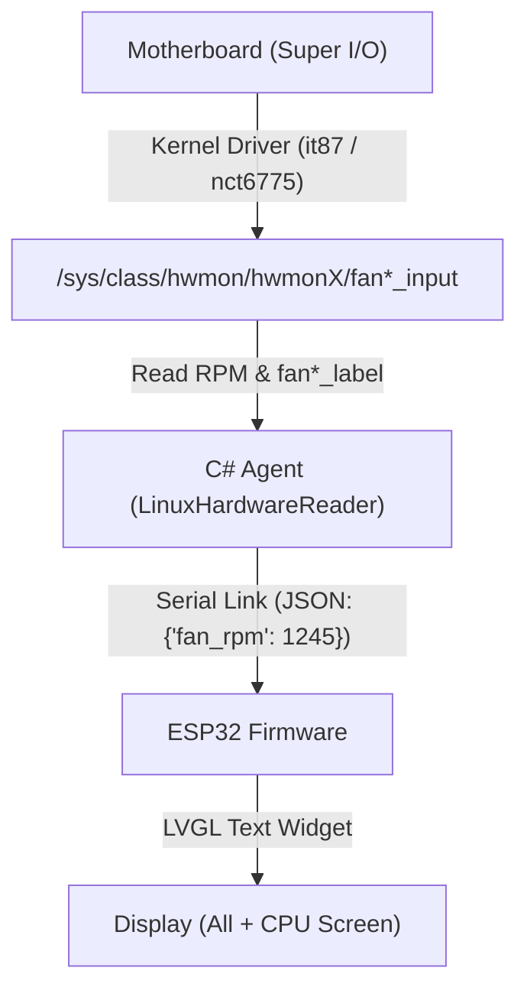

# Enabling CPU Fan Monitoring on Linux (Super I/O Sensors)

*[Česká verze](cpu-fan-linux-setup.md)*

This guide explains how to enable motherboard fan speed monitoring (CPU Fan, System Fans) on Linux and how telemetry data flows through **OpenFrontBase** (C# background agent + ESP32 touchscreen display).

---

## 1. Why Fan Speeds Might Not Appear Automatically

Unlike CPUs and GPUs, which have on-die thermal sensors (such as `k10temp` for AMD or `coretemp` for Intel), chassis and CPU cooler fans are connected directly to motherboard fan headers. These headers are monitored and controlled by a dedicated **Super I/O** hardware controller (commonly manufactured by **ITE** using the `it87` driver, or **Nuvoton / Winbond** using the `nct6775` driver).

Many motherboard BIOSes reserve the memory/IO address range of these Super I/O chips in their ACPI tables. To prevent potential ACPI resource conflicts, the Linux kernel **does not load drivers like `it87` by default**.

Without this driver loaded, no `fan*_input` sensor files are generated in `/sys/class/hwmon`, and monitoring tools cannot read fan RPMs.

---

## 2. Detection & Loading the Driver

### Step 1: Check Current Sensors

Run the standard sensor utility:

```bash
sensors
```

If the output only lists NVMe and CPU package temperatures, but completely lacks any fan entries (`fan1`, `fan2`...), the Super I/O driver needs to be explicitly enabled.

### Step 2: Load the Driver (Example for ITE Chips)

For the widely used ITE controllers found on many modern motherboards, load the `it87` kernel module with the parameter to bypass the ACPI resource conflict check:

```bash
sudo modprobe it87 ignore_resource_conflict=1
```

*(For motherboards utilizing Nuvoton chips, the corresponding module is typically `nct6775`).*

### Step 3: Verify

Run `sensors` again:

```bash
sensors
```

Once the driver attaches to the hardware, a new Super I/O section displaying fan speeds will appear:
```text
it87-isa-0a40
Adapter: ISA adapter
fan1:        1245 RPM  (min =   10 RPM)
fan2:         850 RPM  (min =   10 RPM)
```

---

## 3. Persistent Configuration Across Reboots

To ensure the driver loads automatically on system boot:

### 1. Configure Module Options
Create an option file in `/etc/modprobe.d/`:
```bash
echo "options it87 ignore_resource_conflict=1" | sudo tee /etc/modprobe.d/it87.conf
```

### 2. Enable Auto-Load on Boot
Add the module to `/etc/modules-load.d/`:
```bash
echo "it87" | sudo tee /etc/modules-load.d/it87.conf
```

---

## 4. How OpenFrontBase Processes Telemetry



1. **C# Agent (`LinuxHardwareReader.cs`)**:
   - Scans all `/sys/class/hwmon/hwmon*` directories.
   - Finds available `fan*_input` sensor files. If a corresponding `fan*_label` contains `cpu`, it is selected as the primary CPU fan.
   - Discovery runs dynamically: if the kernel driver is loaded after the agent starts, the agent automatically detects it without requiring a restart.

2. **ESP32 Firmware (`openfrontbase_firmware.ino`)**:
   - Parses `fan_rpm` from the periodic `stat` telemetry JSON message.
   - Updates the UI labels directly: `objects.cpu_fan_text_1` (**All** screen) and `objects.cpu_fan_text` (**CPU** screen).

---

## 5. Troubleshooting

> [!TIP]
> If `sudo modprobe it87` returns `modprobe: FATAL: Module it87 not found`, your current kernel does not have the module built-in. Install it using your distribution's package manager:
> - **Arch Linux / Manjaro / CachyOS**: `sudo pacman -S it87-dkms`
> - **Ubuntu / Debian**: `sudo apt install it87-dkms`

> [!NOTE]
> If your system has multiple fans connected and you want to verify which header corresponds to which sensor, list all sensor labels:
> ```bash
> for f in /sys/class/hwmon/hwmon*/fan*_label; do echo "$f: $(cat $f)"; done
> ```
