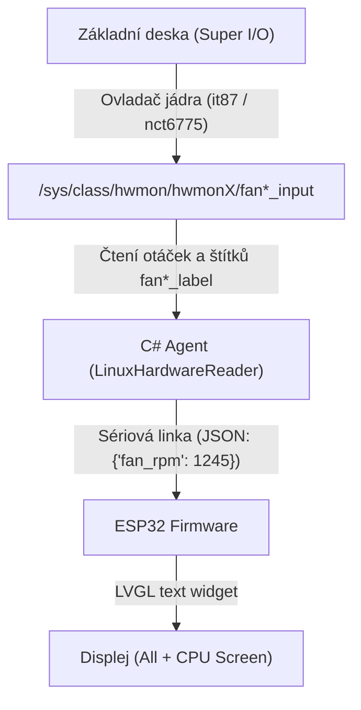

# Zprovoznění čtení CPU Fan na Linuxu (Senzory Super I/O)

*[English version](cpu-fan-linux-setup.en.md)*

Tento návod popisuje, jak na Linuxu zprovoznit čtení otáček ventilátorů základní desky (CPU Fan, System Fan) a jak celý řetězec funguje v projektu **OpenFrontBase** (C# agent + ESP32 displej).

---

## 1. Proč se otáčky na Linuxu nemusí zobrazovat automaticky?

Na rozdíl od procesorů nebo grafických karet, které mají vlastní interní senzory (např. `k10temp` pro AMD nebo `coretemp` pro Intel), jsou ventilátory skříně a chladiče CPU obvykle zapojeny do konektorů na základní desce. Ty jsou řízeny dedikovaným čipem **Super I/O** (nejčastěji výrobci **ITE** – ovladač `it87`, nebo **Nuvoton / Winbond** – ovladač `nct6775`).

Mnoho výrobců základních desek v tabulkách ACPI BIOSu rezervuje adresní rozsah těchto čipů pro systém. Jádro Linuxu proto příslušný ovladač (např. `it87`) **z bezpečnostních důvodů automaticky nezavede**, aby se vyhnulo případnému konfliktu s ACPI. 

Bez zavedeného ovladače nevzniknou v systémové cestě `/sys/class/hwmon` žádné soubory `fan*_input` a aplikace nemají odkud otáčky vyčíst.

---

## 2. Detekce a zavedení ovladače

### Krok 1: Zjištění dostupných senzorů

Pro orientační zjištění, jaký monitorovací čip Vaše základní deska používá, slouží nástroj z balíčku `lm_sensors`:

```bash
sensors
```

Pokud se ve výstupu zobrazují pouze teploty disku (NVMe) a procesoru, ale chybí jakékoliv položky ventilátorů (`fan1`, `fan2`...), je potřeba zavést ovladač čipu Super I/O.

### Krok 2: Načtení ovladače (příklad pro čipy ITE)

Pro nejrozšířenější čipy ITE (využívané u mnoha moderních desek) se modul zavádí s parametrem ignorujícím ACPI konflikt:

```bash
sudo modprobe it87 ignore_resource_conflict=1
```

*(U desek s čipy Nuvoton se analogicky používá modul `nct6775`).*

### Krok 3: Ověření

Znovu spusťte:
```bash
sensors
```

Pokud byl modul úspěšně spárován s hardwarem, objeví se nová sekce senzoru Super I/O obsahující reálné otáčky:
```text
it87-isa-0a40
Adapter: ISA adapter
fan1:        1245 RPM  (min =   10 RPM)
fan2:         850 RPM  (min =   10 RPM)
```

---

## 3. Trvalé nastavení po startu systému (Persistence)

Aby se modul automaticky zavedl při každém bootu PC:

### 1. Nastavení parametrů modulu
Vytvořte konfigurační soubor v `/etc/modprobe.d/`:
```bash
echo "options it87 ignore_resource_conflict=1" | sudo tee /etc/modprobe.d/it87.conf
```

### 2. Automatické zavedení při startu
Přidejte modul do `/etc/modules-load.d/`:
```bash
echo "it87" | sudo tee /etc/modules-load.d/it87.conf
```

---

## 4. Jak probíhá zpracování v OpenFrontBase



1. **C# Agent (`LinuxHardwareReader.cs`)**:
   - Automaticky prohledává všechny adresáře `/sys/class/hwmon/hwmon*`.
   - Vybírá soubory `fan*_input`. Pokud existuje soubor `fan*_label` obsahující řetězec `cpu`, prioritně jej vybere jako ventilátor procesoru.
   - Detekce probíhá dynamicky i za běhu – pokud je modul zaveden až po spuštění agenta, agent senzor sám bez nutnosti restartu objeví.

2. **ESP32 Firmware (`openfrontbase_firmware.ino`)**:
   - Přebírá hodnotu `fan_rpm` ze zprávy typu `stat`.
   - Vykresluje aktuální otáčky do widgetů `objects.cpu_fan_text_1` (obrazovka **All**) a `objects.cpu_fan_text` (obrazovka **CPU**).

---

## 5. Řešení potíží (Troubleshooting)

> [!TIP]
> Pokud systém hlásí `modprobe: FATAL: Module it87 not found`, ovladač není součástí aktuálního jádra. Lze jej doinstalovat přes balíčkovací systém:
> - **Arch Linux / Manjaro / CachyOS**: `sudo pacman -S it87-dkms`
> - **Ubuntu / Debian**: `sudo apt install it87-dkms`

> [!NOTE]
> Pokud máte zapojeno více ventilátorů a chcete ověřit, pod jakým indexem systém eviduje ventilátor chladiče procesoru, vypište si štítky senzorů:
> ```bash
> for f in /sys/class/hwmon/hwmon*/fan*_label; do echo "$f: $(cat $f)"; done
> ```
